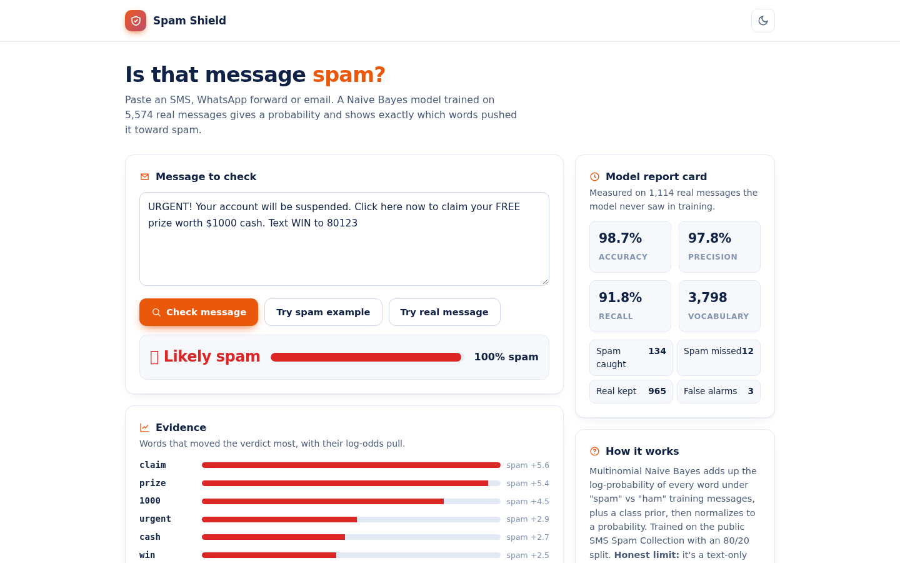
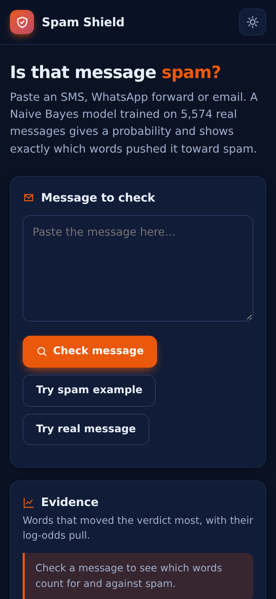

# Spam Shield

Paste an SMS, forward or email and get a spam probability with the exact words that drove the verdict. A multinomial Naive Bayes model trained on the public SMS Spam Collection, running fully in your browser.

**Live demo: https://akash991833.github.io/spam-classifier/**



## Features

- **Real trained model** - trained on 5,574 real SMS messages (80/20 split, seed 42). Only the compact model ships to the browser; classification is instant and offline.
- **Measured, honest metrics** - 98.7% accuracy, 97.8% precision, 91.8% recall on 1,114 held-out messages, with the full confusion matrix shown in the app.
- **Evidence panel** - the words that pulled hardest toward spam or safe, with log-odds bars.
- **Vocabulary transparency** - tells you how many of your words the model actually knows.
- **Dark and light mode**, mobile friendly, installable PWA.



## Honest limits

Text-only model trained on SMS English. New scam wording, URL tricks and sender spoofing can slip past it. A "looks safe" verdict means no red flags found, not a guarantee.

## Tech

Python-trained Naive Bayes exported to a 230 KB JS model; vanilla HTML/CSS/JS frontend. No network calls, no tracking.

## Run locally

```bash
python3 -m http.server 8000
```

---

## 🐍 Python version (real ML backend) - `python-app/`

The browser demo above is fully client-side. This folder is the **pro-grade version** with a real training pipeline on real data:

TF-IDF + logistic regression on 5,574 real SMS (UCI). 98.7% accuracy, F1 0.95, with per-word explanations. Stack: Python, Streamlit, scikit-learn.

```bash
cd python-app
pip install -r requirements.txt
streamlit run app.py
```

Deploy free on **Hugging Face Spaces** (no card): create a Space, upload the `python-app/` folder - it ships Space-ready (`sdk` + `app_file` already set in its README).
